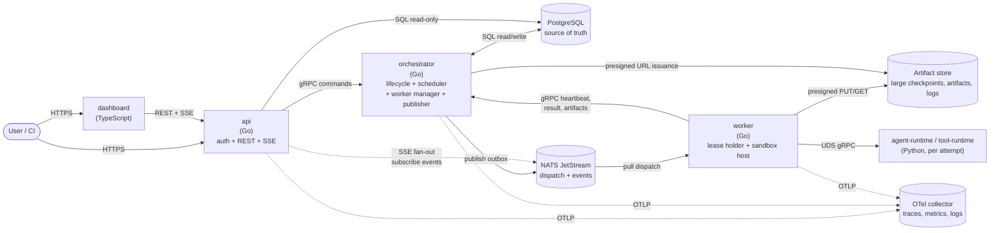
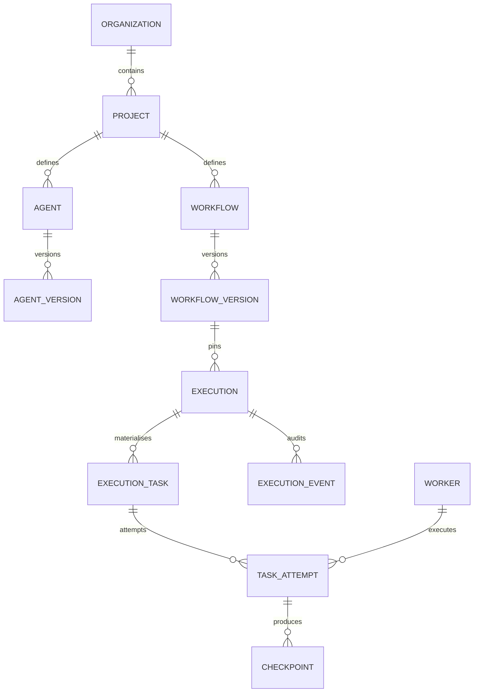
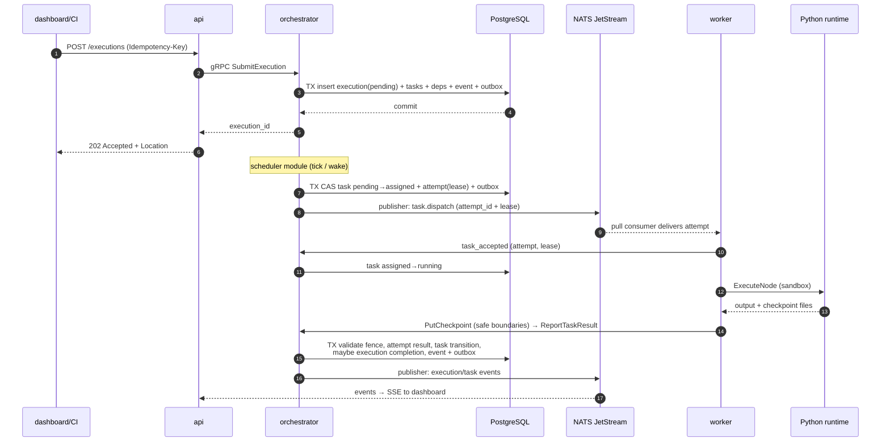

# Architecture

**Status:** accepted for Phase 01 · **Date:** 2026-11-22 · **Supersedes:** none

This document is the entry point. It defines the deployable boundaries, the ownership model, the system-wide
invariants and the end-to-end flows. Details live in the linked documents; the 15 mandatory decisions live in
[`adr/`](adr/README.md).

---

## 1. What we are building

A multi-tenant platform where a user publishes a versioned workflow graph, starts an execution, and watches it
run. Workflow nodes are either **agent** nodes (an LLM agent loop) or **tool** nodes (a deterministic tool or MCP
call). The platform guarantees that execution progress survives process crashes, message duplication and worker
loss, and that every state change is attributable and auditable.

The hard problem is **not** running an LLM. It is making sure exactly one component is allowed to say "this task
succeeded", "this execution failed" or "this work belongs to that worker". This architecture makes that component
the Go orchestrator, and makes every claim it accepts fenced, versioned and durably committed first.

## 2. Goals and non-goals

### Goals

- Durable execution state; no accepted execution exists only in memory.
- Correct behaviour under at-least-once message delivery, process crashes and network partitions.
- Immutable versions for workflows and agents; an execution can always be reproduced structurally.
- Tenant isolation enforced server-side.
- Local single-machine development and later horizontal scaling without changing the domain contracts.
- A small number of deployables in Phase 1. Splitting is an operational decision, not an upfront cost.

### Non-goals for Phase 1

- Exactly-once delivery or exactly-once external side effects. We provide exactly-once **logical state
  transitions** and explicit, declared side-effect safety (ADR 0006).
- Event-sourced replay of an execution from its event log (ADR 0015).
- Multi-region, active-active PostgreSQL, or cross-region execution placement.
- User-supplied code running in the control plane. CEL is the only expression language, and it is sandboxed.
- A general plugin runtime, custom node SDK, or marketplace.
- Tenant-authored tool code or a tenant-visible tool registry. Phase 1 has platform-provided tools only.
- Large artifact download through the public API. The initial contract exposes inline results and artifact metadata;
  a presigned download ticket flow is deferred.
- Sub-second scheduling SLOs. The scheduler targets dispatch within ~1s of eligibility, best effort.
- Kubernetes in Phase 1 (ADR 0012). Docker Compose locally; single-host deployment initially.

## 3. System context

There is exactly one logical writer for each kind of state. The arrows that look redundant (API reads PostgreSQL;
API also subscribes to NATS) are read-only paths for queries and live fan-out. They cannot mutate execution state.

## 4. Deployables and modules

Phase 1 has **four deployables**. Three control-plane modules live inside the orchestrator process and are
separated by package boundary, not network boundary. This is deliberate: the scheduler, worker manager and event
publisher all mutate the same execution schema within the same transaction boundaries, and splitting them now
would turn local transactions into distributed sagas for no operational benefit.

| Deployable | Language | Composition | Responsibility |
|---|---|---|---|
| `api` | Go | gateway + control plane | OIDC authentication, tenant resolution, REST/SSE, project/agent/workflow creation and version publishing, forwarding execution commands to the orchestrator, read-only execution queries. |
| `orchestrator` | Go | lifecycle + `scheduler` + `worker-manager` + `event-publisher` modules | The only writer of execution and task state. Materialises executions, assigns tasks, fences and validates results, decides retries/completion/cancellation, publishes durable events. |
| `worker` | Go | worker agent + Python supervisor | Registers with the orchestrator, holds leases, pulls dispatched attempts, runs each attempt in an isolated runtime process, uploads artifacts/checkpoints, reports fenced results. Never writes PostgreSQL. |
| `dashboard` | TypeScript | Next.js | Developer interface. Talks only to `api`. Renders live state via SSE and historical state via REST. |

The Python **agent-runtime** and **tool-runtime** are packages executed by the worker inside an attempt sandbox.
They are not independently deployed in Phase 1. See [service-responsibilities.md](service-responsibilities.md) for
the full split triggers.

> Naming note: **worker** is the deployable host. **Worker manager** is an orchestrator module that tracks worker
> registration, health and capacity. They are not the same thing.

## 5. Ownership model

This is the mandatory table from the phase brief, made concrete.

| Data | Authoritative owner | Where persisted | Who may write |
|---|---|---|---|
| Organizations, projects, memberships | Go control plane (`api`) | PostgreSQL `control` schema | `api` only |
| Agent definitions and versions | Go control plane (`api`) | `control` | `api` only; versions insert-only from creation |
| Workflow definitions and versions | Go control plane (`api`) | `control` | `api` only; versions insert-only from creation |
| Execution state | Go orchestrator | `execution` schema | `orchestrator` only |
| Task state, task attempts, leases | Go orchestrator | `execution` | `orchestrator` only |
| Worker availability, health, capacity | Go worker manager (orchestrator module) | `execution.workers` + in-process view | `orchestrator` only; workers report, never assert |
| Execution event history (audit) | Go orchestrator | `execution.execution_events` | append-only by `orchestrator` |
| Agent internal state | Python runtime, persisted via checkpoint contract | Small states inline in `execution.checkpoints`; large states in the artifact store | Python produces bytes; worker uploads through `PutCheckpoint`; orchestrator validates, commits and offloads |
| Traces, metrics, logs | Observability infrastructure | OTel backend / log store | services emit; nobody queries it for correctness |

Three rules make this unambiguous:

1. **Python never writes PostgreSQL and never publishes to NATS.** It returns a result to the worker; the worker
   reports it over gRPC; the orchestrator validates and commits it. Python cannot transition a task or execution.
2. **No cross-schema writes.** `api` has a read-only role on `execution`; `orchestrator` has a read-only role on
   `control`. Database grants enforce this, not just code review. See [data-ownership.md](data-ownership.md).
3. **The control plane never mutates a running execution.** Publishing a new workflow version, editing an agent or
   deleting a project does not alter an execution that already references a pinned version. Deletion is soft and
   blocked while non-terminal executions reference the definition.

## 6. Domain model

### Identifiers

- UUIDv7 internally, exposed with a type prefix: `org_`, `proj_`, `agt_`, `agtv_`, `wf_`, `wfv_`, `exec_`, `task_`,
  `att_`, `wrk_`, `evt_`, `ckpt_`, `msg_`.
- `task_attempts` are uniquely identified by `(task_id, attempt_number)` **and** by a `lease_id` UUID that acts as
  the fencing token. Clients of the API never see lease IDs.

### Immutability and versioning

- `workflow_versions` and `agent_versions` are insert-only from creation. Only status transitions are allowed
  (`draft → published → deprecated`); content and digest cannot be edited (enforced by trigger and by absence of an
  update path).
- A workflow version pins **exact agent version IDs** inside its node definitions. The string `latest` is resolved
  at publish time, never at run time.
- An execution references `workflow_version_id` for its whole life. Task rows copy the node's exact agent/tool
  version reference, so every attempt and agent invocation is traceable to an immutable version.
- Every version row carries a content digest (SHA-256 over canonical JSON). Digests make drift detectable and give
  logs/events a stable identity.
- Execution input is capped at 256 KiB and stored on the execution row with a digest. It is immutable.

### Workflow graph

- A graph is a DAG: nodes (`start`, `end`, `agent`, `llm`, `tool`, `condition`, `transform`, `parallel`,
  `join`, `delay`, `approval`, `subworkflow`, `loop`) and edges. Cycles fail publication; bounded loops are
  `loop` nodes that run a child workflow, not back edges.
- Tools are **platform-provided and versioned** in Phase 1. Tenants reference exact built-in tool versions; there is
  no tenant-authored tool registry or code upload. Tool definitions ship with the runtime and are still immutable
  per version. A future tool registry needs an ADR.
- An edge may carry a `when` CEL expression over upstream outputs. A node is **activated if at least one inbound
  edge is true**; if every inbound edge evaluates false, the task is created and then marked `skipped`
  (`branch_not_taken`). Root nodes always run. Unconditional edges are `true`. Joins are expressed by adding an
  unconditional edge from each branch; the node then runs once.
- Full graph rules and the input shape are in [ADR 0007](adr/0007-workflow-graph-representation.md).

## 7. Execution pipeline at a glance

The important asymmetry: **dispatch is a notification, not the source of truth**. Assignment and leases are
committed in PostgreSQL first; the NATS message only tells a worker to look at the committed attempt. If the
message is lost, duplicated, or delivered to a dead worker, the lease reaper repairs the state. See
[communication.md §9](communication.md#9-delivery-guarantees-and-ordering).

## 8. System-wide invariants

Every phase must preserve these. "Enforcement" names the mechanism that makes violation impossible or detectable.

| # | Invariant | Enforcement |
|---|---|---|
| I1 | No accepted execution exists only in memory. | Submission commits `executions` + tasks + outbox in one transaction **before** the API returns 202. A missing commit means no acceptance. |
| I2 | No task has two valid concurrent owners. | Assignment is a conditional `UPDATE ... WHERE state='pending'` that sets one `owner_worker_id` and one `lease_id`. Results are accepted only with the current `(worker_id, lease_id)` and an unexpired lease. |
| I3 | Every task attempt is independently identifiable. | `task_attempts` unique `(task_id, attempt_number)` and unique `lease_id`; every dispatch, result and log carries `attempt_id`. |
| I4 | Every execution references an immutable workflow version. | FK to `workflow_versions`; versions are insert-only from creation; execution rows never update the reference. |
| I5 | Every agent invocation references an immutable agent version. | Workflow version pins `agent_version_id`; task rows copy it; the runtime ABI and image digest must match a worker. |
| I6 | Worker results are validated before committing. | Orchestrator checks schema/fence/state/limits/checkpoint reference; a rejected result is not a task transition. |
| I7 | Duplicate messages cause no duplicate logical transitions. | State transitions are guarded CAS/`SELECT ... FOR UPDATE`; dispatch is keyed by `attempt_id`; results are fenced; API idempotency keys are unique per tenant. |
| I8 | External side effects have explicit retry safety. | Every tool/agent node declares `side_effect_class`; non-idempotent nodes require an idempotency key or `max_attempts=1` (ADR 0006). |
| I9 | Every state transition is auditable. | The transition and its `execution_events` row (actor, from, to, reason, sequence) commit in the same transaction. |
| I10 | Tenant boundaries are enforced server-side. | Route tenant derives from the authenticated principal's membership; every row carries `org_id`; RLS is defense in depth; NATS and object-storage keys are tenant-namespaced. |
| I11 | PostgreSQL is the only correctness authority. | No service makes a decision from cache/NATS alone; caches are invalidated by committed events and are never trusted for writes. |
| I12 | Terminal execution states are immutable. | State-machine guard rejects any transition out of `succeeded`, `failed`, `cancelled`; no API exists to reopen an execution. |

## 9. Walkthroughs (exit criteria)

### 9.1 How a workflow starts

1. The client calls `POST /v1/orgs/{org}/projects/{project}/executions` with `Idempotency-Key`, a published
   workflow id + version, and JSON input. The API authenticates the OIDC token, confirms membership, and rejects
   references outside the route tenant.
2. The API calls `orchestrator.SubmitExecution` over gRPC, carrying `request_id = Idempotency-Key`, the principal,
   the workflow version and input.
3. The orchestrator re-reads the workflow version from `control` (it does not trust the API's copy), validates
   that it is published, materialises one `execution_tasks` row per node plus dependency rows, and inserts the
   `executions` row in state `pending` with `state_version = 1`.
4. In the same transaction it appends `execution.created` to `execution_events` and an outbox row. The transaction
   commits. Only then does the API return `202` with the execution ID. A duplicate request returns the existing
   execution (unique `(org_id, request_id)`), not a second one.
5. The scheduler module sees tasks with no unsatisfied dependencies. Control nodes (`start`, `condition`,
   `transform`, `parallel`, `join`, `end`) are resolved inside the dispatcher transaction; `delay` and `approval`
   persist their wait state; `subworkflow` and `loop` create child executions. Worker nodes (`agent`, `llm`,
   `tool`) are assigned to a worker and follow §9.2. The execution moves `pending → running` when the first
   attempt is accepted or a control node completes.

A workflow that is not published, references a missing agent version, or has an invalid graph never becomes an
execution. Validation failures are `422` and leave no rows.

### 9.2 How a task reaches a worker

1. The scheduler queries eligible tasks: `state='pending'`, all activating inbound edges decided, execution not
   cancelling, retry backoff elapsed. It selects a live worker with a free reserved slot
   (`reserved_slots < min(max_concurrency, reported_available_slots)`) and matching the requested worker pool,
   runtime ABI and runtime image digest.
2. In one transaction it reserves the slot, conditionally updates the task `pending → assigned` setting
   `owner_worker_id`, `lease_id`, `lease_expires_at = now() + 30s`, inserts
   `task_attempts(attempt_number = previous + 1, lease_id)`, updates the execution to `running` if needed, and
   inserts a `task.dispatch` outbox row carrying the `attempt_id` and lease. The slot is released exactly once
   when the attempt closes.
3. The event-publisher module claims outbox rows with `FOR UPDATE SKIP LOCKED` and publishes the envelope to NATS
   subject `tasks.dispatch.<worker_id>` (JetStream work-queue stream `TASK_DISPATCH`).
4. The worker's durable pull consumer (filtered to its own subject) receives the message, verifies the envelope
   tenant/task/attempt against the payload, acknowledges the attempt over the gRPC control stream
   (`task_accepted` with `attempt_id + lease_id`), and starts the sandbox. It does not acknowledge the NATS
   message until the attempt is either accepted by the orchestrator or determined stale.
5. A worker that never accepts does not block progress: the lease expires, the reaper records the attempt as
   `lease_expired`, and the task returns to `pending` for another worker.

### 9.3 How a worker returns its result

1. The worker runs one Python runtime process per attempt and calls `AgentRuntime.ExecuteNode` (or
   `ToolRuntime.ExecuteTool`) over a per-sandbox Unix socket, passing resume checkpoint bytes and a deadline.
2. The runtime writes atomic checkpoint files after each recoverable tool call and at node completion, and returns
   output plus metrics. While the runtime runs, the worker uploads each file with the fenced `PutCheckpoint` RPC.
   The orchestrator validates the envelope, stores small states inline and offloads larger states to its artifact
   store.
3. The worker calls `ReportTaskResult` with `task_id`, `attempt_id`, `lease_id`, outcome, an inline output object
   (always present for success, ≤64 KiB) plus an optional artifact reference for larger data, and a sanitised error.
   Checkpoints were already committed by `PutCheckpoint`; the result never blocks on a large payload. Logs go to
   stdout/artifact storage, never into the result.
4. The orchestrator locks the execution row, then the task row, verifies that `state ∈ {assigned, running}`, that
   `owner_worker_id` and `lease_id` match the current assignment, and that the lease has not expired. It validates
   the result shape against the node's declared output schema and size limits.
5. On acceptance, one transaction updates the attempt, transitions the task, evaluates retry policy, re-evaluates
   execution completion (in the same transaction), appends event(s) and outbox rows, and commits. It replies
   `accepted` or `stale_lease`. A stale or duplicate report never changes state.
6. The worker then acknowledges the NATS message. If it crashes before acknowledging, redelivery produces another
   `ReportTaskResult` that is rejected as stale/duplicate — harmless.

### 9.4 Where execution state is stored

- **PostgreSQL** (`execution` schema) is authoritative for executions, tasks, dependencies, attempts, leases,
  small checkpoints, checkpoint metadata, worker registry, event history and the outbox. See [data-ownership.md](data-ownership.md).
- **Artifact store** holds immutable blobs: large checkpoints, large results/artifacts and optional task logs.
  Small checkpoints stay inline in PostgreSQL. The database stores references plus hashes; a blob without a
  committed reference is garbage and may be deleted. The orchestrator is the only reader/writer; workers upload
  checkpoint bytes over the fenced RPC.
- **NATS JetStream** holds transient dispatch and event messages. It is never read to reconstruct state. Loss of
  all streams delays work only until the reaper/outbox republish.
- **In-memory** structures (scheduler queue, worker capacity view, SSE connections) are caches/accelerators. They
  may be discarded at any moment without changing a logical outcome.

### 9.5 What happens when a worker crashes

1. Heartbeats stop. After `lease_ttl` (30s) the task's lease is expired. The recovery manager runs every 2s with
   PostgreSQL row locks, so concurrent passes cannot double-commit a transition.
2. For each expired lease it records the attempt as `lease_expired` with `outcome_unknown = true`, then applies the
   task's frozen retry policy:
   - retry allowed and budget remains → task `assigned → pending`, `next_attempt_at` set; it is dispatched to
     another worker on a later scheduler tick. `GetTaskContext` returns the latest durable checkpoint, so a crash
     after a tool call resumes after that tool; a completed checkpoint returns the stored output without another
     model call;
   - no retry → task `failed` with `WORKER_LOST`/`EFFECT_UNCERTAIN`, `dead_lettered_at` set, and the execution
     completes per the [failure rules](state-machines/execution.md#4-completion-rules).
3. If the worker was mid-side-effect, the side effect may have happened. The checkpoint does not make tool calls
   transactional. This is why retry safety is declared per node (I8); the platform never silently retries a
   non-idempotent effect.
4. When a worker reconnects after being declared dead, its stale lease is rejected. It kills any orphaned sandbox
   process it still owns and reports nothing that can transition state. A worker never self-fences by writing to
   the database; the fence lives in the orchestrator.

### 9.6 How duplicate messages are handled

There are four duplication points, each handled at a different layer:

| Duplicate | Handling |
|---|---|
| Client retries `POST /executions` | `Idempotency-Key` unique per org on `executions.request_id`; the orchestrator returns the existing execution. API also stores response replay keys for non-execution POSTs. |
| NATS redelivers `task.dispatch` | Worker checks the attempt: if it is already terminal, already owned by another lease, or unknown to the orchestrator, it discards. Acceptance is itself guarded by the `(attempt_id, lease_id)` fence. |
| Worker retries `ReportTaskResult` | The fence (`owner_worker_id`, `lease_id`, state, unexpired lease) admits the first valid report only. Subsequent reports see a terminal state and return `stale_lease`/`already_finished`. The transition is a guarded CAS, not an increment. |
| Duplicate lifecycle event | Events carry a per-execution monotonic `seq` (unique `(execution_id, seq)`); SSE clients receive IDs and dedupe. NATS message IDs come from outbox `message_id` values. Consumers that matter (task state) do not depend on events at all. |

No consumer is allowed to derive task state from an event stream. Events are for humans, dashboards and
observability. State transitions read and write the state rows themselves.

## 10. Security and tenancy

- **Authentication:** OIDC JWT at the API. Browser sessions use HttpOnly cookies; programmatic clients use bearer
  tokens. The dashboard never talks to the orchestrator or database.
- **Authorisation:** route org must match a membership row; org-wide roles (`owner`, `operator`, `viewer`) gate
  mutations. The server never trusts `org_id` in a body or token alone. Role matrix:

  | Action | viewer | operator | owner |
  |---|---|---|---|
  | Read projects, definitions, executions, events | yes | yes | yes |
  | Create/version/publish agents and workflows | no | yes | yes |
  | Start/cancel executions | no | yes | yes |
  | Create/rotate/delete credentials | no | no | yes |
  | Manage members and organisation settings | no | no | yes |

  Platform-operator actions (worker fleet, drain) require a separate identity-provider role and are never granted
  by org membership.
- **Database:** `org_id` on every tenant-owned table, composite FKs where practical, RLS enabled with
  `SET LOCAL app.tenant_id` set by the owning service. Cross-tenant joins are a code-review error and a test
  failure, not a runtime hope.
- **Messaging:** dispatch subjects are per worker; event subjects include `org_id`. Workers are trusted platform
  components but receive only the task they are assigned and short-lived task-scoped credentials. Credentials are
  fetched over gRPC at attempt start and never placed in NATS payloads, checkpoints, results or logs.
- **Execution isolation:** each attempt runs in a fresh Python process with scrubbed environment, temp working
  directory, resource limits and a deadline. Production adds cgroup/no-new-privileges/seccomp and egress control;
  container/microVM isolation is a later upgrade (ADR 0011).
- **Secrets:** stored envelope-encrypted in `control` with a KMS key; API accepts write-only secret values and
  returns names only. Workers never get a database credential.
- **Developer credentials:** API keys are hashed at rest, shown once, role-bound and optionally project-scoped.
  Project keys cannot create projects, manage organisation keys or read outside their project. Revocation is
  immediate. OIDC remains the browser/identity path; keys are for SDKs and automation.

## 11. Deployment and scaling (Phase 1)

- Docker Compose: PostgreSQL 16, NATS 2.x with JetStream, MinIO (S3), `api`, `orchestrator`, one or more `worker`
  containers, `dashboard`.
- Database migrations run as a one-shot job in dependency order: `control` before `execution`.
- `api` and `orchestrator` keep no authoritative state in memory and can run N replicas; caches and worker views are
  rebuilt after restart. Scheduler correctness does not require leader election (CAS assignment + per-attempt
  leases). The reaper uses a PostgreSQL advisory lock so only one replica reaps at a time.
- Workers scale horizontally. Each worker has a stable ID (generated at first boot, stored in its data dir), a pool
  label, a capacity, and a NATS consumer filtered to `tasks.dispatch.<worker_id>`. A drained worker stops
  accepting new attempts and finishes/reports in-flight ones.
- Kubernetes is deferred; the binaries are the same and configuration is environment-based. Split modules out of
  the orchestrator only under the triggers in [service-responsibilities.md §8](service-responsibilities.md#8-split-triggers).

## 12. Glossary

| Term | Meaning |
|---|---|
| Execution | One run of one published workflow version with immutable input. |
| Task | One node of an execution graph. Created at materialisation. |
| Attempt | One delivery of a task to one worker under one lease. |
| Lease | A time-bounded, fenced claim on a task by a worker. |
| Fence | `(worker_id, lease_id)` pair that makes stale results rejectable. |
| Checkpoint | Serialized agent state, stored as an immutable blob referenced by the DB. |
| Outbox | Rows committed with state changes and published to NATS exactly-once-in-effect. |
| Reaper | Orchestrator loop that expires leases, retries or fails tasks, and finalises cancellations. |
| Dispatch | Delivery notification for a committed assignment; not authoritative. |
| Materialisation | Turning a workflow version + input into execution/task/dependency rows. |
| Delegation | A supervisor-requested child execution with an exact agent/version allowlist and budgets. |
| MCP | Model Context Protocol; a pinned stdio or Streamable HTTP server whose tools are discovered and invoked by the runtime. |

## 13. Document map

- [service-responsibilities.md](service-responsibilities.md)
- [communication.md](communication.md)
- [data-ownership.md](data-ownership.md)
- [state-machines/execution.md](state-machines/execution.md)
- [state-machines/task.md](state-machines/task.md)
- [failure-and-recovery.md](failure-and-recovery.md)
- [api/openapi.yaml](api/openapi.yaml), [api/envelope.schema.json](api/envelope.schema.json)
- [adr/](adr/README.md), [../proto/](../proto/)
