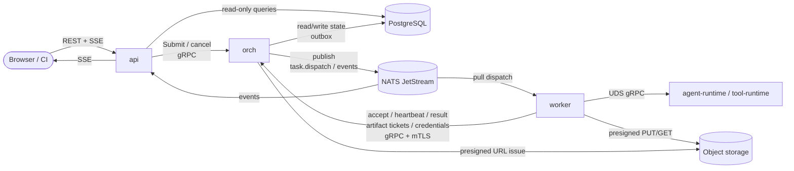

# Communication Protocols

Normative for Phase 1. Defines how every component talks, what is guaranteed, and how contracts evolve.

## 1. Principles

1. **Commands over a network are requests; state is committed in PostgreSQL.** No message on NATS is accepted as
   proof that something happened.
2. **Every internal message is self-describing and tenant-scoped.** Envelope before payload, version before parse.
3. **Consumers are idempotent.** At-least-once delivery is the default everywhere; duplicate suppression is a
   property of the receiver's state machine, not of the broker.
4. **Payloads carry identifiers, not blobs.** Large data goes to object storage; credentials never go on the bus.
5. **Contracts are code.** Protos live in [`../proto`](../proto); OpenAPI lives in [`api/openapi.yaml`](api/openapi.yaml).
   CI validates both and the envelope examples.

## 2. Channel summary



| Channel | Direction | Protocol | Guarantee |
|---|---|---|---|
| Browser/CI → `api` | external | HTTPS REST/JSON, SSE | request/response; SSE at-least-once ordered per execution |
| `dashboard` → `api` | external | same as above | same |
| `api` → `orchestrator` | internal | gRPC over TLS (unary) | retries are safe via request IDs; one logical command per accepted request |
| `worker` → `orchestrator` | internal | gRPC over mTLS (bidi control stream + unary reports) | stream is session-scoped; reports are idempotent and fenced |
| `orchestrator` → NATS → `worker` | internal | JetStream work-queue, durable pull consumer | at-least-once, unordered |
| `orchestrator` → NATS → `api` | internal | JetStream limits stream, ephemeral push/pull consumer | at-least-once, ordered per execution by event `seq` |
| `worker` → Python runtime | local | gRPC over Unix domain socket | at-most-once per call; the sandbox is killed on failure |
| services → object storage | internal | S3 API with presigned URLs | PUT idempotent per key; immutable objects |
| services → OTel collector | internal | OTLP | best effort (telemetry never gates correctness) |

No service calls another service's database. No Python process opens a database or NATS connection.

## 3. External API

Full contract: [api/openapi.yaml](api/openapi.yaml). Summary:

- Base path `/v1`. JSON UTF-8. Timestamps RFC 3339 UTC with milliseconds. IDs are opaque strings.
- Auth: OIDC bearer JWT for programmatic clients. Browser sessions use an HttpOnly cookie issued by the dashboard's
  auth flow; state-changing requests require the session's CSRF token. SSE also authenticates by cookie.
- Tenant: `org_id` is part of the route and checked against membership. It is never taken from the request body.
- Mutations return the resulting resource. `POST /executions` returns `202 Accepted` with `Location` only after
  the orchestrator has committed the execution.
- Idempotency: `Idempotency-Key` is required on `POST .../executions`. Same key + same body returns the original
  response and execution; same key + different body returns `409 idempotency_conflict`. Keys are scoped per org and
  retained 24h after the execution is terminal.
- Errors use one shape: `{ "error": { "code", "message", "details", "request_id" } }`. `code` is stable and
  machine-readable; `message` is human-readable and may change.
- Pagination is cursor-based: `?limit=&cursor=` with opaque `next_cursor`. Default 50, max 100.
- Rate limits are per principal and per org; `429` includes `Retry-After`.
- Maximum request body is 1 MiB. Execution input is capped separately at 256 KiB.
- No WebSocket in Phase 1. Add it only for a genuinely bidirectional interactive feature (terminal streaming,
  collaborative editing, human-in-the-loop dialogs). One-way live updates must use SSE.

### SSE

- `GET /v1/orgs/{org}/projects/{project}/executions/{execution}/stream`
- Content type `text/event-stream`. One execution per connection.
- Event field `id` is the execution event `seq` rendered as a string. `event` is one of
  `execution.created`, `execution.state_changed`, `task.state_changed`, `task.attempt_finished`.
  `data` is the JSON envelope payload plus `seq`.
- On connect, the API replays events after `Last-Event-ID` from PostgreSQL, then tails NATS. Every lifecycle payload
  carries the execution `seq`; the API emits in `seq` order, refetches from PostgreSQL when it observes a gap or an
  out-of-order event across task subjects, and ignores `seq` values it has already sent. It sends a comment
  heartbeat every 15s and a `retry: 3000` hint. Clients must dedupe on `id`; duplicates are expected across a
  replay/tail boundary. A gap detected by the API triggers a fresh DB catch-up.
- The connection is closed after 30 minutes; clients reconnect with `Last-Event-ID`. Polling endpoints remain
  available as a fallback.

### API → orchestrator commands

Contract: [`proto/orchestrator/v1/commands.proto`](../proto/orchestrator/v1/commands.proto). Package
`platform.orchestrator.v1`, service `ExecutionCommands`.

| RPC | Purpose | Idempotency |
|---|---|---|
| `SubmitExecution` | Validate the pinned workflow version, materialise tasks, commit the execution | Unique `(org_id, request_id)`; duplicate returns `replayed=true` |
| `CancelExecution` | Commit `cancel_requested` and start propagation | State-based; repeating is a no-op |
| `DrainWorker` | Relay a platform-operator drain request to the worker manager | Worker state-based |

The API does not write execution tables. These commands are the only path from an external request to a state
change. The orchestrator returns after commit; the API maps `replayed`/`accepted` to its HTTP semantics.

## 4. gRPC — worker control plane

Contract: [`proto/worker/v1/worker.proto`](../proto/worker/v1/worker.proto). Package `platform.worker.v1`.

| RPC | Direction | Purpose |
|---|---|---|
| `Connect(stream WorkerMessage) returns (stream OrchestratorMessage)` | bidi | One session per worker. Registration, heartbeat, task acceptance, cancellation, drain. |
| `ReportTaskResult` | unary | Fenced result for one attempt. Idempotent. |
| `CreateArtifactUpload` | unary | Presigned PUT for checkpoint/artifact/log produced by an attempt. |
| `CreateArtifactDownload` | unary | Presigned GET for a checkpoint the worker must resume from. |
| `GetTaskContext` | unary | Pinned task/node/agent/tool specs, execution input and upstream outputs for an accepted attempt. Fenced by `(attempt_id, lease_id)`. |
| `GetTaskCredentials` | unary | Short-lived, task-scoped credentials at attempt start. Never cached on disk. |

### Session rules

- The worker opens `Connect` with `Hello{worker_id, boot_id, pool, labels, capacity, runtime_abis,
  runtime_digests, binary_version, join_token, runtime, runtime_version, capabilities, resources{cpu_cores,
  memory_mb}}`. The orchestrator returns `HelloAck{session_id, heartbeat_interval_ms=5000, lease_ttl_ms=30000,
  server_time}`. `boot_id` is stable for the lifetime of the worker process and changes on restart.
- A worker restart with the same `worker_id` and a new `boot_id` immediately closes that worker's open attempts as
  `lease_expired` and returns the tasks to the scheduler; it does not wait for the lease TTL.
- The worker sends `Heartbeat` every 5s with every active `(task_id, attempt_id, lease_id)`, its current
  `Capacity`, CPU percentage, memory used, runtime version and status (`starting`, `available`, `busy`, `draining`,
  `unhealthy`, `terminated`). Receiving a heartbeat renews those leases **only if** the orchestrator's current
  assignment matches, the lease is still unexpired (`lease_expires_at > now()`), and the execution is still
  `pending`/`running`. An expired lease is never revived. Renewal stops once the execution is
  `cancel_requested` or `failing`; lease expiry is the bounded backstop for cancellation.
- `task_accepted` transitions the task `assigned → running` if the fence matches and the lease is live.
- `task_progress` is advisory telemetry (step, percentage, message). It is never a state transition, may be
  dropped, and is not persisted as an execution event. Progress is not a lease renewal; the heartbeat is.
- `cancel` tells the worker to terminate an attempt. Cancellation is also enforced by lease expiry if the worker is
  unreachable.
- A session is invalid when the stream closes. The worker reconnects with exponential backoff (1s..30s) and
  re-registers with the same `boot_id`. Outstanding leases are resumed only for attempts the worker still owns and
  lists in its heartbeat. If the `boot_id` differs, the orchestrator treats the previous process as dead: it closes
  all open attempts from that boot immediately as `lease_expired`, before the new session accepts any dispatch.
  In-flight sandboxes from the old process must already have been killed by the worker at startup.
- Production uses mTLS with worker identity bound to the certificate; `join_token` exists only for local
  development. The orchestrator authorises each RPC against the caller's worker identity and the attempt's owner.

### Result RPC semantics

- Request fields: `task_id`, `attempt_id`, `lease_id`, `attempt_number` (monotonic generation; rejected if it does
  not match), `outcome ∈ {SUCCEEDED, FAILED, CANCELLED}`, inline `output` object (required for success, may be
  empty, ≤64 KiB), optional `output_artifact` for bulk data (never a substitute for the inline output), optional
  `checkpoint` reference, `failure{code, message, classification, effect_uncertain}`, `metrics`, timestamps,
  runtime version.
- Response `status ∈ {ACCEPTED, ALREADY_FINISHED, STALE_LEASE, VALIDATION_FAILED, RETRY_LATER}`. `ACCEPTED` means
  the transition committed. `STALE_LEASE`/`ALREADY_FINISHED` mean stop and discard. `RETRY_LATER` is only for
  transient orchestrator/database unavailability and must be retried within the current lease; the worker must not
  treat it as success or failure.
- The RPC deadline is 10s. The worker retries idempotently with jitter while the lease is live. If the lease
  expired, it reports once, then stops; the reaper owns recovery.
- The orchestrator never accepts a result from a worker that is not the current owner, even if the message is
  cryptographically valid. Lease comparison uses the database clock, never the worker's.

## 5. gRPC — Python runtime

Contract: [`proto/runtime/v1/runtime.proto`](../proto/runtime/v1/runtime.proto). Package `platform.runtime.v1`.
One runtime process is started per attempt and listens on a private Unix socket created by the worker (0700
directory, random path, per-process token in `metadata`).

- `AgentRuntime.ExecuteNode(ExecuteNodeRequest) → ExecuteNodeResponse`
- `ToolRuntime.ExecuteTool(ExecuteToolRequest) → ExecuteToolResponse`

Requests carry `execution_id`, `task_id`, `attempt_id`, `node_id`, tenant/project, the pinned agent/tool version
spec, resolved inputs/params, optional checkpoint reference (as bytes fetched by the worker), deadline,
`traceparent`, and short-lived credentials. Responses carry output JSON, optional checkpoint bytes, metrics, and a
classified failure. Details and limits are in ADR 0008.

The worker owns the process lifecycle: deadline → `SIGTERM`, 5s grace, `SIGKILL`, then reap. gRPC context
cancellation alone is not trusted to stop tenant code. The runtime has no network listener beyond the UDS and no
database/NATS credentials.

Phase 07 implements the runtime side: `agent_runtime serve --socket`, the LangGraph adapter and the provider
registry. The runtime emits one structured JSON event per line (`task_started`, `agent_initialized`,
`model_request_started`, `model_response_received`, `tool_invocation_started`, `tool_invocation_completed`,
`agent_completed`, `task_failed`); the worker forwards them to its stdout. Output is validated against the pinned
node schema by the worker before reporting. Checkpoint bytes are produced at node end, but durable upload is not
wired yet; live token streaming requires a streaming runtime RPC and is deferred.

## 6. NATS JetStream

### Streams and subjects

| Stream | Subjects | Retention | Purpose |
|---|---|---|---|
| `TASK_DISPATCH` | `tasks.dispatch.<worker_id>` | `workqueue`, max age 24h, max bytes 4 GiB, duplicate window 2m | Durable hand-off of a committed attempt to one worker. |
| `EVENTS` | `events.>` | `limits`, max age 72h, max bytes 2 GiB, duplicate window 2m | Live UI fan-out of execution lifecycle events. Never read for correctness. |
| `TASK_DLQ` | `tasks.dlq.<worker_id>` | `limits`, max age 7 days, max bytes 1 GiB | Dead-lettered dispatch messages with the original envelope, delivery count, error and execution context for inspection and controlled redrive. |

Event subject schema:

```
events.org.<org_id>.execution.<execution_id>.<event>
events.org.<org_id>.execution.<execution_id>.task.<task_id>.<event>

  events.org.org_123.execution.exec_456.created
  events.org.org_123.execution.exec_456.state_changed
  events.org.org_123.execution.exec_456.task.task_789.state_changed
  events.org.org_123.execution.exec_456.task.task_789.attempt_finished
```

The API subscribes to `events.org.<org_id>.>` only. It never subscribes to another tenant's subject. NATS account
permissions should enforce that filter in production; Phase 1 uses a shared account with subject ACLs, and the API
also filters after receipt.

### Dispatch consumer

Each worker creates one durable pull consumer on `TASK_DISPATCH`:

- `durable = "worker-<worker_id>"`, `filter_subject = "tasks.dispatch.<worker_id>"`, explicit ack,
  `ack_wait = 60s`, `max_deliver = 5`, exponential backoff, `max_ack_pending = capacity`.
- It fetches a batch no larger than free capacity. A message is acknowledged only after the worker has either
  committed the attempt result through the orchestrator (`ReportTaskResult`) or determined the attempt is
  stale/foreign and dropped it. Acceptance alone is not enough: a broker ack is not task completion. If the worker
  crashes first, redelivery happens, but the lease is the real recovery mechanism.
- If redelivery exhausts `max_deliver`, the message is dead-lettered to `tasks.dlq.<worker_id>` with the original
  envelope and a failure reason. This is an alert, not a state transition; the reaper still owns the task.
- Workers have publish permission only to their own `tasks.dlq.<worker_id>` subject and no subscribe permission to
  other workers' dispatch subjects. Production issues per-worker credentials at registration; local development
  uses a shared development account.

### Event consumer

The API uses an ephemeral consumer with `deliver_policy = new` per SSE connection after performing a DB catch-up.
Events are decoded only if `schema_version` is supported; unknown message types are ignored and counted. Consumers
never assume NATS ordering across subjects; per-execution ordering comes from the event `seq` field.

### Dead letters and redrive

- A handler may classify a failure as permanent (malformed payload, wrong worker, invalid result) or transient.
  Permanent failures are published to `tasks.dlq.<worker_id>` immediately; transient failures are `Nak`ed with
  exponential backoff and dead-lettered after `max_deliver` attempts.
- The DLQ envelope preserves the original message bytes, subject, message ID, tenant/project/execution/task/attempt
  identifiers, delivery count, error text and failure time. It is an alert and an audit record, never a state
  transition; the reaper still owns the task.
- The consumer acknowledges the original only after the DLQ publish succeeds, so a failed DLQ publish cannot lose
  the message.
- Operators redrive with `POST /v1/messaging/dlq/redrive` on the orchestrator's operator surface
  (`ORCHESTRATOR_ADMIN_TOKEN`). Redrive republishes the original envelope to its original subject and acknowledges
  the DLQ row only after the republish succeeds. Normal fencing still applies: a redriven message whose task is
  already terminal is acknowledged as a duplicate.

### Deduplication

- Outbox `message_id` is sent as the `Nats-Msg-Id` header. The broker suppresses duplicate publishes inside the
  duplicate window; this is an optimisation, not a guarantee.
- Beyond the window, duplicates are still harmless because every consumer is either idempotent (SSE dedupes by
  `seq`) or fenced (worker results). No consumer may use "message was seen" as the only idempotency mechanism for a
  logical transition.
- Task results are reported over gRPC, not NATS. The result transaction is the durable completion; the broker ack
  follows it.

## 7. Message envelope

Every NATS message uses this envelope. Normative JSON Schema: [`api/envelope.schema.json`](api/envelope.schema.json).

```json
{
  "message_id": "msg_01J8Z6R5T9K3M2V7Q4W8X1Y0Z6",
  "message_type": "task.dispatch",
  "schema_version": 1,
  "tenant_id": "org_01J8Z6...",
  "project_id": "proj_01J8Z6...",
  "execution_id": "exec_01J8Z6...",
  "task_id": "task_01J8Z6...",
  "attempt_id": "att_01J8Z6...",
  "worker_id": "wrk_01J8Z6...",
  "timestamp": "2026-11-22T12:00:00.000Z",
  "correlation_id": "exec_01J8Z6...",
  "causation_id": "evt_01J8Z6...",
  "traceparent": "00-4bf92f3577b34da6a3ce929d0e0e4736-00f067aa0ba902b7-01",
  "payload": {}
}
```

| Field | Required | Meaning |
|---|---|---|
| `message_id` | yes | Unique, stable across retries. Used as `Nats-Msg-Id` and for audit correlation. |
| `message_type` | yes | Canonical type, e.g. `task.dispatch`. Selects the payload schema. |
| `schema_version` | yes | Integer version of **this message type's payload contract**. Starts at 1. |
| `tenant_id` | tenant-scoped types | `org_id`. Consumers reject missing/foreign tenant. |
| `project_id` | tenant-scoped types | Project scope. |
| `execution_id`, `task_id`, `attempt_id` | per type | Correlation; absent when not applicable (omit or `null`, do not use empty string). |
| `worker_id` | worker-targeted types | Target or reporting worker. |
| `timestamp` | yes | Producer time, UTC. Never used for ordering or lease decisions. |
| `correlation_id` | no | Root workflow/execution correlation. Defaults to `execution_id`. |
| `causation_id` | no | The event/command that caused this message. |
| `traceparent` | no | W3C Trace Context, propagated across NATS and gRPC. |
| `payload` | yes | Type-specific object. Never contains secrets or blobs >64 KiB. |

### Message types (v1)

| `message_type` | Produced by | Payload (v1) |
|---|---|---|
| `task.dispatch` | orchestrator publisher | `attempt_id` (envelope), `attempt_number`, `lease_id`, `task_id` (envelope), `node_id`, node type, pinned `agent_version_id`/`tool_version_id`, spec digest, `deadline`, `lease_expires_at`. The worker fetches the full pinned spec, inputs and credentials over gRPC (`GetTaskContext`, `GetTaskCredentials`) after acceptance, so the bus stays small and no secrets or blobs travel on it. |
| `execution.created` | orchestrator publisher | `seq`, `workflow_version_id`, `state`, `state_version`, `counts`. Enables early UI display; catch-up remains REST. |
| `execution.state_changed` | orchestrator publisher | `seq`, `from`, `to`, `state_version`, `reason`, `failure_code?`, `counts`. |
| `task.state_changed` | orchestrator publisher | `seq`, `task_id`, `node_id`, `from`, `to`, `reason`, `attempt_id?`, `skip_reason?`, `state_version`. |
| `task.attempt_finished` | orchestrator publisher | `seq`, `attempt_id`, `attempt_number`, `worker_id`, `outcome`, `error_code?`, `effect_uncertain`, `duration_ms?`. |

Worker fleet changes are not execution events. The dashboard reads the worker list from the API; live fleet
streaming is deferred.

Adding a message type is additive. Changing a payload in a non-additive way increments that type's
`schema_version`.

## 8. Versioning rules

### Envelope

- Envelope is version 1. Additive optional fields may be introduced without a bump; consumers must ignore fields
  they do not know.
- Removing a field, widening/narrowing a type, or changing the meaning of an existing field requires a new envelope
  version and an ADR. Dual-publishing is allowed for at most one release window.

### NATS message payloads

- `schema_version` is per `message_type`, independent of envelope version.
- Within a version: optional fields may be added; enum values may be added only if consumers treat unknown values as
  a non-fatal "unknown" case; required fields and semantics are frozen.
- A consumer must support the current and previous versions of any type it handles during a rollout. Unknown
  message types are ignored, not crashed on.
- Payload examples and JSON Schemas live with the producer's tests; CI checks backward compatibility. No runtime
  schema registry in Phase 1. Trigger for one: more than two producer teams or non-Go producers.
- Timestamps are ISO-8601 UTC strings; identifiers are strings; money/quantities are not in messages.

### gRPC / protobuf

- Package version `v1`. Add fields with new numbers; never reuse numbers; reserve removed numbers/names.
- Unknown fields are preserved/ignored by protobuf; breaking changes require a new package version and a migration
  window. gRPC status codes are the error contract; `details` may carry a `ErrorInfo`.
- Worker and orchestrator negotiate `runtime_abi` and control `protocol_version` in `Hello`. A worker whose
  protocol is unsupported is rejected with `FAILED_PRECONDITION` and registers as incompatible.

### REST

- `/v1` is additive-only. Breaking changes go to `/v2`; the previous version is supported for at least 90 days
  after the new version ships. Deprecations are announced with `Deprecation` and `Sunset` headers.
- Enum values added to responses must be tolerated by clients; the dashboard treats unknown states as `unknown`
  and refuses mutations until refreshed.

## 9. Delivery guarantees and ordering

| Path | Delivery | Duplicates | Ordering | Loss behaviour |
|---|---|---|---|---|
| API request | caller-controlled | prevented by idempotency key | n/a | caller retries; no partial acceptance |
| Outbox → NATS | at-least-once | broker window + idempotent consumer | not guaranteed | publisher retries until marked; DB state unaffected |
| NATS → worker | at-least-once | possible; deduped by attempt/lease state | not guaranteed; an older attempt can arrive after a new one | lease reaper reassigns; stale dispatch is rejected |
| Worker → orchestrator result | at-least-once retry by worker | fenced; first valid report wins | not guaranteed | lease expiry recovers |
| Orchestrator state change | exactly-once logical transition | guarded CAS + fence | per task serialised by row lock | transaction rolls back fully |
| Event → API → SSE | at-least-once | possible across catch-up/tail; dedupe by `seq` | per execution ordered by `seq` | API refetches from DB; clients reconnect |
| Object storage | idempotent PUT per key | same key overwrite is same content | n/a | reference not committed → orphan garbage collected |

There is no global ordering guarantee and no need for one. The only order that matters is the order of guarded
transitions on a single task/execution row, which PostgreSQL provides.

## 10. Time, retries and failure detection

- All authoritative times (leases, deadlines, expiry) use the PostgreSQL clock (`now()`). Producer timestamps are
  diagnostic only.
- Worker heartbeat: 5s. Orchestrator considers a worker unhealthy after 15s without heartbeat, dead after the
  lease TTL (30s). Unhealthy workers receive no new assignments; existing leases continue until expiry.
- Lease: 30s TTL, renewed implicitly by a heartbeat that lists the attempt. Maximum clock skew between orchestrator
  replicas is expected to be <1s because leases are computed in the database; worker clock skew is irrelevant.
- Retry policy: exponential backoff with full jitter, base 1s, cap 60s, unless the node overrides. The scheduler,
  not the worker, decides whether and when to retry.
- gRPC retries: only idempotent calls. `ReportTaskResult` is idempotent by fence; `Connect` starts a new session;
  artifact URL creation is idempotent per `(attempt_id, kind)`.

## 11. Security of channels

- External: TLS only; HSTS; strict CORS allowlist; CSRF token on cookie-authenticated mutations.
- Internal gRPC: TLS required outside localhost; production mTLS. Worker identity is bound to `worker_id`; a
  worker cannot report for another worker even with a valid certificate.
- NATS: per-worker credentials constrained to its dispatch subject and DLQ; API credentials restricted to
  `EVENTS` read. Phase 1 may run a single NATS account in development only.
- Object storage: presigned URLs are scoped to one object key, one method, 15-minute expiry, and issued only after
  verifying the attempt's lease. Keys are unguessable and tenant-prefixed. No long-lived S3 credentials on workers.
- Payload limits: JSON messages ≤256 KiB, dispatch ≤64 KiB, inline results ≤64 KiB, checkpoints ≤32 MiB via object
  storage, a single output artifact or log ≤64 MiB, task context response ≤4 MiB, gRPC max message 4 MiB for the
  worker control plane. The local runtime UDS allows 40 MiB so a 32 MiB checkpoint plus overhead fits in one
  response; checkpoint bytes never cross the worker↔orchestrator gRPC boundary (they go through object storage).
  The worker rejects oversized artifacts and fails the attempt with `ARTIFACT_TOO_LARGE`.
