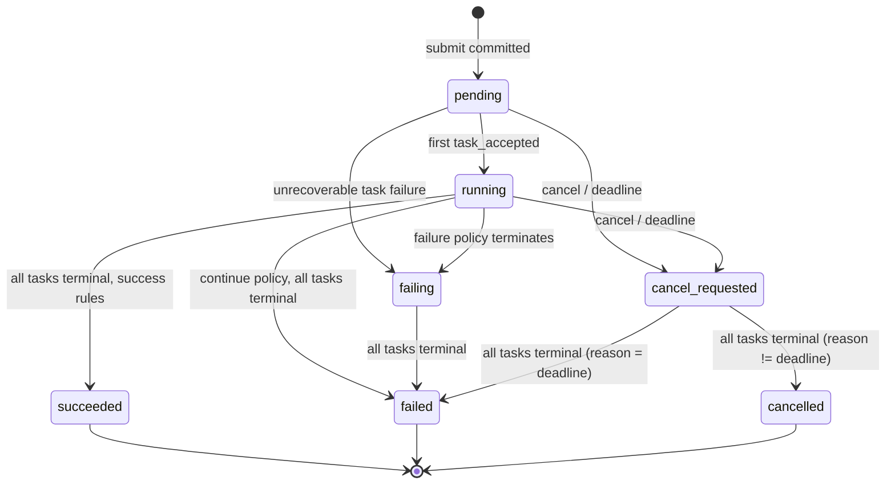

# Execution State Machine

Normative. Only the orchestrator's lifecycle module may transition an execution. Every transition is a guarded
write (compare `state` and `state_version`) plus an `execution_events` row in the same transaction.

## 1. States

| State | Terminal | Meaning |
|---|---|---|
| `pending` | no | Accepted and durably committed. Tasks materialised. No task attempt has been accepted by a worker yet. |
| `running` | no | At least one task attempt has been accepted. Work may be in flight or between attempts. |
| `failing` | no | An unrecoverable task failure has occurred. Remaining tasks are being cancelled; waiting for quiescence. |
| `cancel_requested` | no | A user or deadline cancellation has been accepted. Cancellation is propagating; scheduling has stopped. |
| `succeeded` | yes | Every task is terminal, at least one succeeded, none failed or was cancelled, and the only skips are branch-related. |
| `failed` | yes | Every task is terminal and the execution has an unrecoverable failure (including timeout and failure-policy termination). |
| `cancelled` | yes | Every task is terminal after an explicit cancellation whose reason was not a deadline. |

`failing` and `cancel_requested` exist so that **terminal means quiescent**. We never declare `failed` while a
worker may still be executing a task. A terminal execution is immutable (I12).

## 2. Lifecycle



There are no other transitions. In particular:

- `pending → succeeded/failed` is not allowed except through the paths shown (`pending → failing → failed`).
- A terminal state never transitions again.
- Cancellation is sticky: once in `cancel_requested`, the execution cannot end `succeeded`, even if every task
  happens to finish successfully while cancellation propagates. Task success is still recorded; the execution ends
  `cancelled`.
- Direct `running → failed` is allowed **only** when `continue` policy has left the execution quiescent and at least
  one task failed. It is not a shortcut around failure propagation; `fail_fast` always passes through `failing`,
  which cancels in-flight work.

## 3. Transition table

`actor` is the component that commits. "System" means scheduler, reaper or completion evaluator inside the
orchestrator, acting without a user request.

| # | From → To | Trigger | Guard | Side effects (same transaction) |
|---|---|---|---|---|
| E1 | — → `pending` | `SubmitExecution` | Published workflow version; valid graph/input; unique `(org_id, request_id)` | Insert execution, tasks, dependencies, `execution.created` event, outbox. Commit before API returns 202. |
| E2 | `pending → running` | Task `assigned → running` (worker accepted) | Execution state still `pending`; at least one attempt accepted | Set `started_at`; increment `state_version`; event; outbox `execution.state_changed`. |
| E3 | `running → running` | Nothing | — | No transition. Task activity does not bump execution `state_version`. |
| E4 | `pending → failing` | A task reaches terminal `failed` before any acceptance (e.g. no compatible worker, attempts exhausted) | Failure policy says terminate | Record `failure_code`; enter failure propagation; cancel all non-terminal tasks. |
| E5 | `running → failing` | Task failure is terminal under **`fail_fast`** | Task is terminal `failed`; execution not already cancelling | Record first `failure_code`/`failure_detail`; cancel in-flight tasks; pending tasks → `cancelled`; stop scheduling. |
| E6 | `pending → cancel_requested` | `CancelExecution` API or `deadline_at` reached | Execution not terminal; cancel not already requested | `cancel_epoch += 1`; set `cancel_reason ∈ {user, deadline}`; cancel all pending tasks. |
| E7 | `running → cancel_requested` | Same as E6 | Same as E6 | Same as E6, plus send cancel commands for active attempts. |
| E8 | `running → succeeded` | Completion evaluator after a task transition | Success rules (§4) | Set `ended_at`; event; outbox. |
| E9 | `running → failed` | Completion evaluator after a task transition | **`continue` policy**, all tasks terminal, at least one failed, none cancelled | Set `ended_at`; keep recorded `failure_code`; event; outbox. |
| E10 | `failing → failed` | Completion evaluator after the last task becomes terminal | All tasks terminal | Set `ended_at`; keep recorded `failure_code`; event; outbox. |
| E11 | `cancel_requested → cancelled` | Completion evaluator after the last task becomes terminal | All tasks terminal and `cancel_reason != deadline` | Set `ended_at`; event; outbox. |
| E12 | `cancel_requested → failed` | Completion evaluator after the last task becomes terminal | All tasks terminal and `cancel_reason = deadline` | Set `ended_at`; `failure_code = EXECUTION_TIMEOUT`; event; outbox. |

Every transition increments `state_version` by exactly 1 and appends one `execution.state_changed` event with
`from_state`, `to_state`, `state_version`, `actor`, `reason`, and for terminal transitions the final counts.

### Duplicate and racing transitions

The lifecycle handler locks the execution row (`SELECT ... FOR UPDATE`) or uses:

```sql
UPDATE executions
   SET state = $to, state_version = state_version + 1, ...
 WHERE id = $id AND state = $from AND state_version = $expected;
```

Zero rows means the transition is stale. The handler re-reads and returns the current representation rather than
retrying blindly. Concurrent evaluators (result handler and reaper) therefore cannot both commit the same
transition.

## 4. Completion rules

Completion is evaluated **inside the same transaction** as the task transition that may have finished the last
piece of work. It is a pure function of the current task rows plus workflow policy.

### Success (only from `running`)

All of the following must hold:

1. Every task is terminal (`succeeded`, `failed`, `cancelled` or `skipped`).
2. No task is `failed` or `cancelled`.
3. At least one task is `succeeded`.
4. Every `skipped` task has `skip_reason ∈ {branch_not_taken, upstream_not_taken}`.

If a task is skipped because a dependency failed, condition 2 is already false, so the execution cannot succeed.

### Failure

- `fail_fast` (default): the first unrecoverable task failure moves the execution to `failing` (E5) and cancels
  everything else. When all tasks are terminal, `failed` (E10).
- `continue`: the failure is recorded, its dependents are skipped, independent work continues. When all tasks are
  terminal and at least one failed, the execution transitions directly `running → failed` (E9). It never has
  in-flight work at that point. This gives partial results without pretending the run succeeded.
- A task that fails without ever producing a result (lease exhaustion, incompatible runtime, invalid result after
  retries) triggers the same policy.

### Cancellation vs failure precedence

- If `cancel_requested` was entered first, the execution ends `cancelled` (or `failed` for a deadline), even if
  some tasks later report failure. Task-level outcomes are preserved.
- If `failing` was entered first, a later user cancel is a no-op (`409` to the caller, no transition); the
  execution ends `failed`.
- `failed` due to a deadline is distinguishable by `failure_code = EXECUTION_TIMEOUT`; `cancel_reason = deadline`.

## 5. Cancellation

- `POST .../executions/{id}:cancel` is idempotent. If already `cancel_requested` or `cancelled`, return the current
  representation with `202`. If `succeeded`, `failed` or `failing`, return `409 execution_terminal_or_failing`.
- Entering `cancel_requested` increments `cancel_epoch` once. Duplicate requests do not increment it. The epoch is
  passed to workers with the cancel command and included in the control stream message so stale cancels can be
  ignored.
- The scheduler stops assigning tasks immediately (`cancel_requested` and `failing` are not schedulable states).
- Lease renewals also stop: heartbeats no longer extend attempts in a cancelling or failing execution. The cancel
  command is the fast path; lease expiry is the bounded backstop. Cancellation therefore cannot be held open by a
  worker that keeps heartbeating but never stops.
- Pending tasks become `cancelled` with no attempt. Assigned/running attempts get a cancel command; the worker
  kills the sandbox (`SIGTERM`, grace, `SIGKILL`) and reports `CANCELLED` if it can.
- If a worker is unreachable, the reaper waits for lease expiry, records the attempt as `lease_expired` with
  `outcome_unknown = true`, marks the task `cancelled`, and sets `effect_uncertain` when the attempt had started.
  The execution can then finalise. Cancellation never waits forever on a dead worker.
- Cancellation does **not** roll back side effects. It is best effort and explicitly documented as such.
- Execution deadline is an automatic cancellation with `cancel_reason = deadline`. It finalises as `failed` with
  `EXECUTION_TIMEOUT`. Reaching the deadline while already `failing` keeps the failure path; while already
  `cancel_requested` due to a user, the user cancellation wins.
- No cascading to child executions exists in Phase 1 (executions do not spawn executions). If added later, each
  child is cancelled by the parent's workflow logic, not by an implicit recursive rule; this needs an ADR.

## 6. Deadlines and timeouts

| Timer | Owner | Effect |
|---|---|---|
| `executions.deadline_at` | Reaper | Auto-cancel with `deadline`; terminal `failed`/`EXECUTION_TIMEOUT`. |
| Node `timeout_seconds` | Orchestrator, enforced by worker | Attempt killed at deadline; result `TASK_TIMEOUT`; retry policy applies. The reaper also expires the lease if the worker never reports, so a dead worker cannot extend a task. |
| Lease TTL (30s) | Reaper | Attempt `lease_expired`; task retried or failed per policy. |
| Worker heartbeat (5s) | Worker-manager | No new assignments after 15s of silence; leases still expire individually. |

Deadlines are stored as absolute `timestamptz` values computed with the database clock. The worker receives the
remaining duration, not a wall-clock timestamp, to avoid clock skew.

## 7. Execution input and version pinning

- Input is immutable, ≤256 KiB, stored with a digest, and included in every root task's input snapshot.
- `workflow_version_id` is set at creation and never updated. Deleting or republishing the workflow has no effect
  on the execution.
- Task rows copy the exact `agent_version_id` or `tool_version_id` from the pinned workflow graph. The
  orchestrator requires the workflow version to be `published` at materialisation. A referenced agent/tool version
  may be `deprecated` only if the workflow version was published while it was still published; deprecation never
  breaks an existing pinned graph.
- A retry never re-resolves versions. A retry resumes the same pinned versions and the latest checkpoint for that
  task.

## 8. Persistence and auditing

- Execution creation (E1) and every later transition are single transactions that include the state row, affected
  task rows, `execution_events` and outbox rows.
- `execution_events.seq` is allocated from `executions.next_event_seq` while holding the execution row lock, so
  sequences are gap-free per execution and unique, starting at 1 for `execution.created`. Events are append-only.
- **Lock order is fixed: execution row first, then task rows.** Every writer (scheduler, result handler, reaper)
  follows it. This is what makes event sequencing, retry decisions and completion evaluation race-free and
  deadlock-free; an eligibility scan that starts from task IDs must re-lock the execution and re-check before
  committing.
- Terminal transitions record final counts and `ended_at`; later maintenance updates (payload redaction, retention)
  never change `state`, `state_version`, `started_at`, `ended_at` or the event log.
- Metrics are derived from committed events/state, not from in-memory counters.

## 9. Forbidden transitions and edge cases

| Attempt | Result |
|---|---|
| `succeeded → running` | Rejected; executions are not reopened. Re-run by creating a new execution. |
| `failed → cancelled` | Rejected; terminal is final. |
| `cancel_requested → succeeded` | Rejected; cancellation is sticky. |
| `running → failed` outside E9 | Rejected; `fail_fast` must pass through `failing`, and `continue` cannot fail while work is active. |
| Cancel a terminal or failing execution | `409`, except already `cancelled` which returns 202 idempotently. |
| Result arrives after execution terminal | Task transition rejected by fence/state; logged with attempt/trace IDs, no execution event. |
| Worker claims success for another worker's attempt | Rejected by `(owner_worker_id, lease_id)` fence and mTLS identity. |
| Deadline and completion at the same instant | Serialised by the execution row lock. If completion commits first, terminal wins and the deadline is ignored. If deadline commits first, the execution ends `failed`/`EXECUTION_TIMEOUT`. Deterministic either way, never both. |
| Orchestrator crashes after committing a transition, before publishing | Outbox publish resumes; SSE may briefly lag, state is correct. |
| Orchestrator crashes before commit | Nothing happened; the retry or reaper repeats the operation idempotently. |

## 10. Test obligations

The implementation's state-machine tests must cover, at minimum:

- every allowed transition and every forbidden transition in §3/§9;
- duplicate `task_accepted`, duplicate `ReportTaskResult`, and stale lease results;
- completion evaluation in the same transaction as the last task transition;
- `fail_fast` vs `continue` with skipped dependents;
- cancel while pending, while running, while a worker is dead, and after terminal;
- deadline while running, while failing, and while already cancel-requested;
- reaper/result races under two concurrent transactions (expected one winner);
- no execution row exists after a failed submission transaction.
