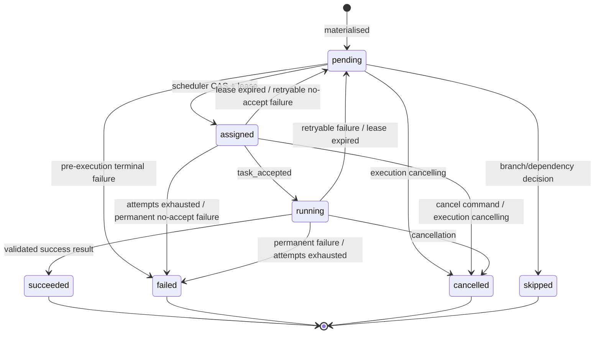

# Task State Machine

Normative. Only the orchestrator may transition a task. A task represents one node of one execution. Work happens
in **attempts**; every attempt has an independent identity, a lease and a fence. A worker's opinion is a request
for a transition, never a transition itself.

## 1. States

| State | Terminal | Meaning |
|---|---|---|
| `pending` | no | Created, not currently leased. May be waiting for dependencies, retry backoff or a compatible worker. |
| `assigned` | no | Leased to one worker; dispatch published. The worker has not yet accepted. |
| `running` | no | Worker accepted the attempt and is executing the node in a sandbox. |
| `succeeded` | yes | A validated result with outcome success was committed. |
| `failed` | yes | Attempts exhausted, a permanent failure was committed, or policy forbade retry. |
| `cancelled` | yes | Cancelled by execution cancel/failure propagation. May have had side effects. |
| `skipped` | yes | Deliberately not run: branch not taken, upstream not taken, or dependency failed. |

There is no `retrying` state and no `cancelling` state. Retry returns the task to `pending` with backoff. Cancellation
moves directly to `cancelled` once the attempt is terminated or fenced off; the old attempt row retains what
happened.

## 2. Attempts, leases and fences

An **attempt** is one dispatch of one task to one worker.

| Field | Rule |
|---|---|
| `attempt_number` | Starts at 1, increments per dispatch, unique per task. |
| `attempt_id` | Unique ID (`att_...`). Stable across retries of the same dispatch, result reports and artifact uploads. |
| `worker_id` | The worker selected by the scheduler. Immutable for the attempt. |
| `lease_id` | UUID generated by the orchestrator at assignment. **The fencing token.** Never generated or reused by a worker. |
| `lease_expires_at` | `now() + 30s` at assignment; renewed by heartbeats that list this attempt only while the fence matches, the lease is still unexpired and the execution is schedulable. An expired lease is never revived. |
| `outcome` | Set only when the attempt closes: `succeeded`, `failed`, `cancelled`, `lease_expired`, `incomplete`. |
| `outcome_unknown` | True when the worker died or lost contact; we do not know whether the process finished. |
| `effect_uncertain` | True when an attempt that had started is abandoned and the node may have produced external effects. |

Rules:

- At most one open attempt per task (partial unique index on `task_attempts(task_id) WHERE finished_at IS NULL`).
- `lease_id` is globally unique and is included in every worker→orchestrator message for that attempt:
  accept, heartbeat, result, artifact URL request and credential fetch. Mismatch is rejected.
- Lease expiry is evaluated with the PostgreSQL clock only. Worker clocks are irrelevant.
- A result is accepted only if **all** hold: the task is `assigned` or `running`; `owner_worker_id` equals the
  reporting worker; `lease_id` equals the current lease; the lease has not expired; the attempt is the open
  attempt. Otherwise the result is rejected and state is unchanged.
- Retries create new attempts. The previous attempt row is immutable once closed. This is how "every task attempt
  is independently identifiable" survives retries.

## 3. Lifecycle

## 4. Transition table

| # | From → To | Actor | Guard | Effects (one transaction) |
|---|---|---|---|---|
| T1 | — → `pending` | Orchestrator (materialisation) | Node exists in pinned graph; versions valid; execution committed | Insert task, dependencies, attempt budget, `side_effect_class`; event. |
| T2 | `pending → assigned` | Scheduler | Execution `pending`/`running`; eligible (§5); `attempt_count < max_attempts`; `next_attempt_at <= now()`; worker status `available`/`busy` with a free slot (`reserved_slots < min(max_concurrency, reported_available_slots)`); required capability, runtime ABI and image digest match; tenant/provider/tool admission limits permit | CAS `WHERE state='pending'`; increment `attempt_count`; **reserve one worker slot** (`reserved_slots += 1`), set `busy` when full; set owner, new `lease_id`, `lease_expires_at`; insert open attempt with monotonic `attempt_number`; update `latest_attempt_id`; outbox `task.dispatch`. |
| T3 | `assigned → running` | Worker via `task_accepted` | Fence matches; lease unexpired; execution not `cancel_requested`/`failing` | Set `started_at`; attempt `accepted_at`/`started_at`; event. |
| T4 | `assigned → pending` | Reaper or result handler | Lease expired, or worker rejected transiently (busy/shutting down); retry allowed; execution still schedulable | Close attempt `lease_expired` or `failed` with the rejection code (`WORKER_BUSY`); release slot; set `next_attempt_at`; clear owner/lease; event. |
| T5 | `assigned → failed` | Reaper or result handler | Lease expired or worker rejected permanently; no retry allowed | Close attempt `lease_expired` or `failed` with error code; event; completion evaluation. |
| T6 | `running → succeeded` | Result handler | Fence matches; lease unexpired; result validates; outcome `SUCCEEDED` | Close attempt `succeeded`; store inline result/artifact ref/checkpoint ref; event; completion evaluation. |
| T7 | `running → failed` | Result handler or reaper | Fence matches (or lease expired for reaper); attempt outcome failure; validation passed; retry not allowed | Close attempt `failed`/`lease_expired`; store a valid checkpoint if reported; set error code; event; completion evaluation. |
| T8 | `running → pending` | Result handler or reaper | Retry allowed and budget remains; execution still schedulable | Close attempt (`failed`/`lease_expired`); set `next_attempt_at`; clear owner/lease; event. No dispatch in this transition; the scheduler dispatches later. |
| T9 | `pending → cancelled` | Reaper / lifecycle | Execution `cancel_requested` or `failing`; or cancel came before assignment | No attempt; `skip_reason=null`; event; completion evaluation. |
| T10 | `assigned/running → cancelled` | Result handler or reaper | Execution `cancel_requested`/`failing`, or user cancel propagated | Close attempt `cancelled` (or `lease_expired` if unreachable, with `effect_uncertain`); event; completion evaluation. |
| T11 | `pending → skipped` | Scheduler | Activation decided false or unavailable (§5) | Set `skip_reason`; event; completion evaluation. No attempt. |
| T12 | `pending → failed` | Scheduler / lifecycle | Terminal pre-execution failure: CEL evaluation error (`EDGE_EVALUATION_FAILED`) or a pinned version/runtime became unassignable for a non-retryable reason | Set error code; no attempt; event; completion evaluation. |

Notes:

- T8 never publishes dispatch inside the result transaction. Scheduling is a separate decision: capacity, labels
  and backoff may have changed. Only T2 dispatches.
- A duplicate `task_accepted` with the same `(worker_id, lease_id)` while the task is already `running` is a no-op
  success; one with a different lease is stale. It is not an error and must not kill the sandbox.
- If a lease expires for an attempt whose `task.dispatch` outbox row was never published, the reaper closes it as
  `incomplete`, returns the task to `pending`, and does **not** charge the retry budget. It never reached a worker.
  This is the only budget-decrementing path ([failure-and-recovery.md §3.2](../failure-and-recovery.md#32-dispatch-never-sent-nats-down-or-publisher-crash)).
- A worker whose session is replaced by a new boot (same `worker_id`, new `boot_id`) has its open attempts closed
  as `lease_expired` immediately, not after the TTL. This makes restart recovery fast and prevents the new process
  from inheriting a lease it cannot honour.
- A heartbeat never revives an expired lease (`lease_expires_at > now()` is required). A worker that was
  partitioned past the TTL is stale even if its next heartbeat succeeds.
- T4 and T8 differ only in whether the worker had accepted. Both close the old attempt and may retry.
- T10 wins over T8/T7 when the execution is cancelling: do not retry into a cancelled execution.
- T12 exists because a task can fail before any attempt: an invalid CEL edge or a permanently unassignable pinned
  runtime. It is terminal and consumes no attempt budget (no attempt exists). It still triggers execution failure
  evaluation.
- A worker reporting `CANCELLED` is accepted only if the execution is `cancel_requested`, the task was explicitly
  cancelled, or the worker is draining and the lease is about to expire. Otherwise it is recorded as a failure
  `WORKER_CANCELLED` and retry policy applies. Workers cannot silently abandon work and call it cancellation.

### Attempt count and retry budget

- `attempt_count` counts dispatches, including leases that were never accepted and attempts that were killed.
- `max_attempts` comes from the node spec (default 1). Every closed attempt that reached a worker counts; the sole
  exception is a dispatch that was never published (see the note above), which never reached a worker.
- `next_attempt_at` uses exponential backoff with full jitter: `min(60s, 1s * 2^(attempt-1)) * rand(0.5..1.5)`,
  overridable per node.
- Exhausting the budget closes the task `failed` with the last error code (`LEASE_EXPIRED`, `TASK_TIMEOUT`,
  `WORKER_LOST`, `RESULT_INVALID`, etc.).

## 5. Eligibility and skip rules

The scheduler considers a `pending` task only when:

1. The execution is `pending` or `running` (never `failing`, `cancel_requested` or terminal).
2. `next_attempt_at IS NULL OR next_attempt_at <= now()`.
3. `attempt_count < max_attempts`.
4. Every inbound dependency is terminal (either succeeded, failed or skipped).
5. The edge activation resolves to **true**, or the task is a root.
6. A live worker matches the task's requested `worker_pool` (if set), required capability
   (`agent_execution`/`tool_execution`), runtime ABI and runtime image digest, and has a free slot.
7. The tenant active-task cap permits another assignment.
8. The pinned model provider and tool concurrency caps permit another active task.

Candidates are ordered per tenant by `priority DESC, created_at` and then interleaved by tenant rank, with an
effective priority that adds one point per minute waited (capped at 200). This is FIFO for equal priorities,
priority-aware within a tenant, capacity-aware in worker selection and tenant-fair across a dispatch pass; aging
prevents permanent starvation.

### Edge evaluation

Each edge `dep → task` has an optional CEL expression. With upstream terminal:

| Upstream outcome | Edge outcome |
|---|---|
| `succeeded` and `when` absent/true | `true` |
| `succeeded` and `when` false | `false` |
| `failed` or `skipped` | `unavailable` |
| CEL evaluation error | **task fails** with `EDGE_EVALUATION_FAILED` (terminal, no attempt). This is a definition bug, not a transient condition. |

A task activates if **at least one** inbound edge is `true`. If none is true:

- at least one `unavailable` → `skipped` with `skip_reason = dependency_failed`;
- otherwise → `skipped` with `skip_reason = branch_not_taken`.

If a task is skipped and another task depends on it, that dependent sees `unavailable` and cascades as
`upstream_not_taken` (not `dependency_failed`) so a branch-not-taken chain does not fail the execution. Roots always
activate. This OR semantics is deliberate; a join is expressed with unconditional edges so that one true branch is
enough to run it. Full graph rules are in [ADR 0007](../adr/0007-workflow-graph-representation.md).

Skip decisions are made transactionally. Only one component may commit a given skip (CAS on `state='pending'`).
Task failure never implicitly cancels siblings; that is the execution failure policy's job (`fail_fast` cancels,
`continue` lets independent work finish).

## 6. Result validation

The orchestrator validates before committing (I6). Any failure here closes the attempt as `RESULT_INVALID` or
`VALIDATION_FAILED` per the table below; it never becomes a task success.

| Check | Rejection outcome |
|---|---|
| Fence: state, owner, lease, unexpired, open attempt | `STALE_LEASE` response; no state change, no new attempt. The worker must discard. |
| Attempt/task/execution identifiers agree | `VALIDATION_FAILED`; result discarded. Repeated violations close the attempt as failed `PROTOCOL_ERROR`. |
| Outcome enum is one of `SUCCEEDED/FAILED/CANCELLED` | `VALIDATION_FAILED`. |
| Success has an inline JSON output object (may be empty, ≤64 KiB). Artifacts are optional extra data, never a substitute: routing edges need the inline value. Artifact ref (if any) has matching hash/size | Attempt failed `RESULT_INVALID`; retry policy applies. |
| Output matches the node's declared output schema, when present | Attempt failed `RESULT_SCHEMA_INVALID`; retry policy applies. |
| Checkpoint reference belongs to this attempt, hash/size match, schema/ABI supported | Attempt failed `CHECKPOINT_INVALID`; retry policy applies unless a checkpoint was optional. A checkpoint reported with a failed/cancelled result is committed if valid and may be used by the next attempt. |
| Failure classification is known | Unknown → `WORKER_ERROR` (treated as transient by default, never as success). |
| `CANCELLED` legitimacy | Accepted only as defined in §4; otherwise treated as failure. |

Validation is structural and policy-level. The orchestrator does not re-run the agent or second-guess model output
quality. "Success" means the runtime returned a well-formed success result under a valid lease; product-level
grading belongs to the workflow.

## 7. Cancellation and deadlines

- On execution `cancel_requested` or `failing`, the lifecycle handler cancels `pending` tasks immediately (T9) and
  sends cancel commands for active attempts (T10 path). The worker kills the sandbox and may report `CANCELLED`.
  Heartbeats stop renewing leases for cancelling/failing executions, so an uncooperative worker loses ownership
  within one TTL and the reaper finalises the task.
- If the worker is dead or partitioned, the reaper waits for lease expiry and closes the attempt `lease_expired`
  with `outcome_unknown=true`; if the attempt had started, `effect_uncertain=true`.
- Task `timeout_seconds` is enforced twice: the worker kills the runtime at the deadline; the orchestrator's reaper
  expires the lease at the same deadline if no report arrives. A late success is rejected by the fence. This
  prevents a hung worker from holding a task indefinitely.
- A timeout closes the attempt with `TASK_TIMEOUT` and follows retry policy. The execution deadline is separate and
  lives in [execution.md](execution.md#6-deadlines-and-timeouts).
- Cancellation is never rolled back. Checkpoints taken before cancellation remain valid resume points for a future
  new execution or manual retry, but the task itself is terminal.

## 8. Workflow node policy fields that affect task behaviour

| Field | Default | Effect |
|---|---|---|
| `worker_pool` | none | Optional placement constraint; the scheduler only assigns workers registered in that pool. |
| `max_attempts` | 1 | Dispatch attempts, including lease expiry. |
| `retry_on` | `[transient, timeout, worker_lost]` for read-only; narrower for side-effecting | Which failure classes may return the task to `pending`. |
| `timeout_seconds` | 600 | Per-attempt runtime deadline, enforced by worker and reaper. |
| `side_effect_class` | `read_only` | `read_only`, `idempotent`, `non_idempotent`. Non-idempotent requires an idempotency key or `max_attempts=1` (ADR 0006). |
| `output_schema` | none | Optional JSON Schema for result validation. |
| `checkpoint_mode` | `on_node_end` | `none`, `on_node_end`. The checkpoint is committed with the result; mid-node streaming is not in Phase 1. |
| `require_checkpoint` | false | If true, a failed checkpoint upload fails the attempt instead of degrading to a warning. |

Publishing a workflow validates these fields and their combinations. The orchestrator re-validates at
materialisation and again when applying retry policy.

## 9. Persistence rules

- Task state, attempt row and execution completion evaluation share one transaction. Lock order is **execution row
  first, then task row** (see [execution.md §8](execution.md#8-persistence-and-auditing)); the scheduler's initial
  scan is advisory and must re-check eligibility under that lock before committing.
- The assignment CAS (T2) and attempt insert and outbox row share one transaction. A dispatch can never exist for
  an assignment that did not commit, and an assignment can never exist without a dispatch (outbox is durable).
- Attempt rows are append-only after close. Corrections are new events, not edits.
- `owner_worker_id`, `lease_id`, `lease_expires_at` are cleared on every transition to `pending`, `succeeded`,
  `failed`, `cancelled` or `skipped`. A closed task never advertises an owner.
- The scheduler reserves one worker slot at T2 (`workers.reserved_slots += 1`). The same transaction that closes the
  attempt (T4–T8, T10) releases it exactly once. T12 has no attempt and reserves nothing. If reconciliation ever
  finds a drift, it recomputes from open attempts and alerts; it never blocks assignment on a negative counter.
- Task events (`task.state_changed`, `task.attempt_finished`) are appended to the execution event log with the same
  per-execution sequence. Task state is read from `execution_tasks`, never reconstructed from events.

## 10. Edge cases

| Case | Behaviour |
|---|---|
| Duplicate dispatch with the same `attempt_id` | Worker checks with the orchestrator; if the attempt is not open for this worker/lease, it discards and acks. |
| Older attempt result arrives after retry | Fence compares the lease; rejected as `STALE_LEASE`, no transition. |
| `task_accepted` arrives after lease expiry but before reaper | Rejected. If the reaper has not run yet, the worker is told the lease is stale and must kill the sandbox. |
| Two schedulers assign simultaneously | CAS on `state='pending'` means exactly one wins; loser re-reads. |
| Worker reports success with an unexpired lease, then the reaper kills the task | Cannot happen: the result transaction and the reaper serialise on the task row; only one closes the attempt. |
| Task becomes eligible while execution cancels | Scheduler transaction checks execution state; no assignment. Reaper cancels the pending task. |
| Node has `max_attempts=1` and the worker disappears mid-side-effect | Task fails `WORKER_LOST`/`EFFECT_UNCERTAIN`; it is not retried. Operator sees the uncertainty flag. |
| Upstream succeeded but CEL is invalid at runtime | Dependent task fails `EDGE_EVALUATION_FAILED`; execution follows its failure policy. |
| Checkpoint incompatible on resume | Attempt fails `CHECKPOINT_INCOMPATIBLE`; the node may restart from scratch only if its policy allows (`checkpoint_mode=none` or explicit `restart_on_incompatible=true`). Otherwise it fails. |
| All tasks skipped except a root that fails | Normal failure path; execution `failing → failed`. |
| A task is cancelled, then a late result arrives | Fence sees a terminal task; rejected. The rejection is logged with the attempt/trace IDs but cannot resurrect the task. |

## 11. Test obligations

- Every transition allowed and every forbidden one (including terminal immutability).
- Race tests: two assignments, result vs reaper, cancel vs result, heartbeat renewal vs expiry.
- Attempt identity across retries, including lease reuse attempts (must be rejected) and stale report rejection.
- Edge activation truth table: true/false/unavailable/error, OR semantics, cascading skip reasons.
- Retry policy: classification × side-effect class × budget, ensuring non-idempotent nodes are never retried
  without declared safety.
- Result validation: oversized output, bad schema, mismatched checkpoint, unknown enum, cancelled legitimacy.
- Verification that no path from Python to a task success exists without an accepted, fenced orchestrator commit.
